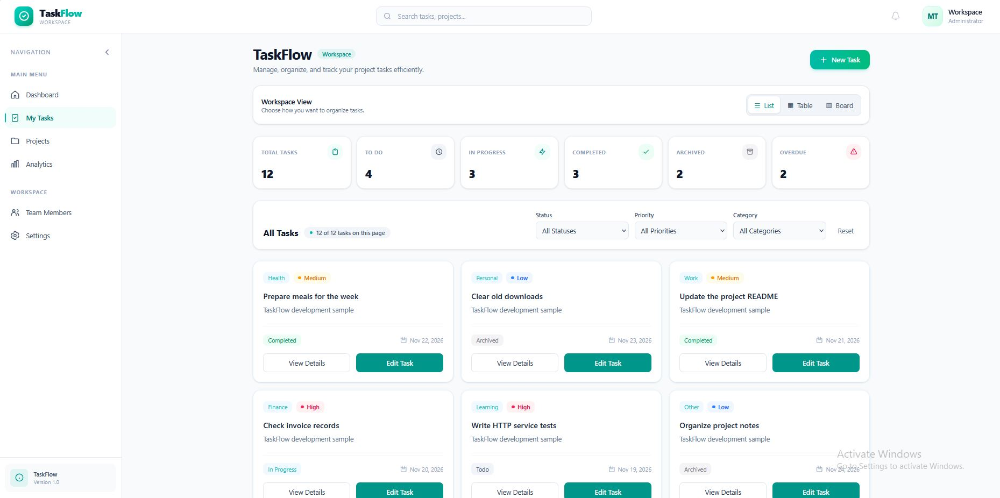
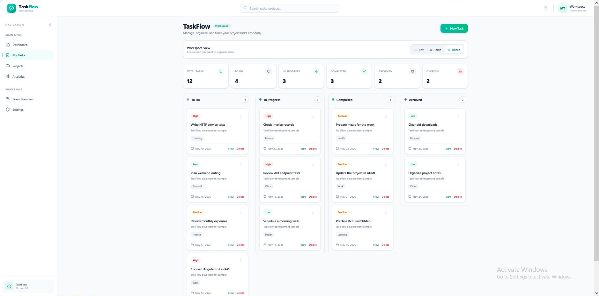
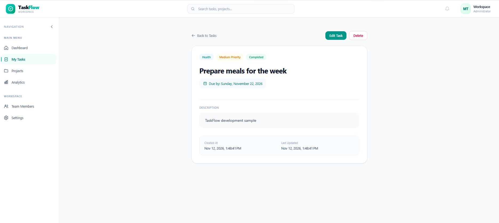

# TaskFlow

**TaskFlow** is a full-stack task management application built with **Angular, TypeScript, Tailwind CSS, FastAPI, SQLModel, and SQLite**. It is a practical engineering project focused on clean REST APIs, reusable frontend components, reactive state, automated testing, and a disciplined Git/GitHub workflow.

> **Status:** ✅ **V1.0.0 release candidate** (November 16, 2026). Core task CRUD, List/Table/Kanban views, and Kanban drag-and-drop persistence have passed manual acceptance testing. The backend suite passed **37 tests**, and the Angular production build succeeded. The official `v1.0.0` Git tag and GitHub release are pending.

## Tech Stack

| Layer | Technologies |
| --- | --- |
| Frontend | Angular (standalone components), TypeScript, Tailwind CSS |
| Frontend architecture | Angular Signals, reactive forms, feature-based components, smart/presentational separation |
| Backend | Python, FastAPI |
| ORM and validation | SQLModel, SQLAlchemy, Pydantic |
| Database | SQLite (development) |
| Testing | pytest, FastAPI TestClient / HTTPX |
| Workflow | Git, GitHub, feature branches, pull requests, Conventional Commits |
| Containerization | Docker, Docker Compose |
| Web server / Reverse proxy | Nginx |

## Features

### Backend — implemented

- Task creation, retrieval, listing, partial update, and deletion, with SQLite persistence.
- Statuses: `todo`, `in_progress`, `completed`, `archived`.
- Priorities: `low`, `medium`, `high`.
- Categories: `work`, `personal`, `learning`, `health`, `finance`, `other`.
- Optional due dates and `created_at` / `updated_at` timestamps.
- Paginated task listing with filtering by status, priority, and category.
- Sorting by `created_at` or `due_date`, ascending or descending.
- Case-insensitive title/description search, including escaped SQL LIKE wildcards.
- Due-date range filtering with timezone-aware query validation.
- Database-wide task statistics: total, counts by status, and overdue unfinished tasks.
- Non-paginated task retrieval by status for the Kanban board (appropriate for V1-scale datasets).
- Request validation, HTTP error handling, CORS for local Angular development, Swagger/OpenAPI documentation, and health check.

### Frontend — implemented

- Angular standalone application with nested routes, a responsive header and sidebar, desktop sidebar collapse, and mobile navigation drawer.
- Task list and reusable task components, including task cards, filters, and statistics UI.
- Reactive task create/edit forms with validation.
- Angular service integration with FastAPI for **real create, read, update, and delete operations**.
- Task listing with filtering and pagination functionality.
- List, table, and Kanban board views.
- Kanban drag-and-drop task status updates, persisted through the API and SQLite (verified after a browser refresh).
- Angular Signals, component inputs/outputs, and smart/presentational component patterns.
- Tailwind-based responsive design.

> **Scope note:** Task CRUD and Kanban changes use live API data, not mock-only data. The `/tasks/stats` backend endpoint exists, but the README review has not verified whether the frontend statistics cards consume it; confirm from the current code before claiming API-backed statistics. Some secondary navigation entries may remain placeholders.


## Screenshots

### Task List View

Manage tasks with filtering, statistics, priority indicators, and quick editing.



### Kanban Board

Organize tasks by status using drag-and-drop, with changes persisted to the database.



### Task Details

View task information, status, priority, due dates, and timestamps.



## Project Structure

```text
taskflow/
├── backend/
│   ├── main.py                 # FastAPI endpoints
│   ├── models.py               # SQLModel models, enums and API schemas
│   ├── database.py             # Engine and session dependency
│   ├── requirements.txt
│   └── tests/
│       ├── conftest.py         # Isolated test setup
│       └── test_tasks.py       # API tests
├── frontend/
│   ├── src/
│   │   └── app/
│   │       ├── layout/         # Main layout, header, sidebar
│   │       ├── features/
│   │       │   └── tasks/      # Task pages, models, services, components
│   │       └── core/          # Shared application infrastructure
│   ├── package.json
│   └── angular.json
├── docs/                      # Architecture, API, development logs, roadmap
├── .gitignore
└── README.md
```

*Simplified overview; consult the source tree for exact filenames and directories.*

## Getting Started

### Prerequisites

- Python 3.11+ and `pip` (development tests were run with Python 3.12).
- Node.js and npm compatible with the Angular version in `frontend/package.json`.
- Git.

### 1. Clone the repository

```bash
git clone https://github.com/mustafataha5/taskflow.git
cd taskflow
```

> The V1 release candidate is on `main`. For future development, use feature branches and pull requests.

### 2. Start the FastAPI backend

```bash
cd backend
python3 -m venv .venv
source .venv/bin/activate
python -m pip install -r requirements.txt
uvicorn main:app --reload
```

On Windows, activate the environment with `.venv\Scripts\activate` instead.

- API: <http://127.0.0.1:8000>
- Swagger UI: <http://127.0.0.1:8000/docs>
- OpenAPI schema: <http://127.0.0.1:8000/openapi.json>

The development SQLite database is initialized by the backend application.

### 3. Start the Angular frontend

In a second terminal, from the repository root:

```bash
cd frontend
npm install
npx ng serve
```

Open <http://localhost:4200>. Keep the backend running for live task CRUD. The backend currently allows the local frontend origin `http://localhost:4200` through CORS.


## Running TaskFlow with Docker

TaskFlow supports **Docker Compose** to run the complete application using Angular, Nginx, FastAPI, and SQLite.

### Prerequisites

- Docker Engine
- Docker Compose V2

### Start the application

From the project root:

```bash
docker volume create taskflow-data
docker compose up --build -d
```

Open **http://localhost:8080** to access TaskFlow.

Docker Compose starts two services:

- **Frontend:** Angular production build served by Nginx.
- **Backend:** FastAPI application using SQLModel and SQLite.

Nginx forwards `/api/*` requests to the backend container.

### Useful commands

```bash
# Check container status
docker compose ps

# View logs
docker compose logs -f

# Restart services
docker compose restart

# Stop and remove containers
docker compose down

# Rebuild after code changes
docker compose up --build -d
```

### Database persistence

SQLite data is stored in an external named Docker volume called `taskflow-data`.

The database persists across normal container restarts and recreation.

**Important:** The volume is separate from the local development database (`backend/taskflow.db`). Do not remove the volume if you want to preserve your Docker application data.

### Accessing the application

| Service | URL |
|---|---|
| Angular application | http://localhost:8080 |
| API through Nginx | http://localhost:8080/api/tasks |
| API health check | http://localhost:8080/api/health |

The FastAPI backend is accessible through the internal Docker network rather than requiring a separate published host port.

## API Reference

| Method | Endpoint | Description |
| --- | --- | --- |
| `GET` | `/health` | API health check |
| `GET` | `/tasks` | Paginated task listing, search, filtering and sorting |
| `GET` | `/tasks/stats` | Database-wide status counts and overdue count |
| `GET` | `/tasks/by-status/{task_status}` | All tasks with a specified status; no pagination |
| `GET` | `/tasks/{task_id}` | Retrieve a task by ID |
| `POST` | `/tasks` | Create a task |
| `PATCH` | `/tasks/{task_id}` | Partially update a task |
| `DELETE` | `/tasks/{task_id}` | Delete a task (`204 No Content`) |

### Create a task

`POST /tasks`

```json
{
  "title": "Implement Kanban board",
  "description": "Add columns for task statuses",
  "status": "todo",
  "priority": "high",
  "category": "learning",
  "due_date": "2026-12-01T18:00:00Z"
}
```

### Partially update a task

`PATCH /tasks/1`

```json
{
  "status": "in_progress",
  "priority": "medium"
}
```

Only supplied fields are updated; a non-empty PATCH updates `updated_at`. The optional `due_date` may be cleared with `null`.

### List, search, filter and sort

```http
GET /tasks?page=1&page_size=10&status=todo&priority=high&sort_by=due_date&order=asc
GET /tasks?q=angular&category=learning
GET /tasks?due_after=2026-11-01T00:00:00Z&due_before=2026-12-01T00:00:00Z
```

| Parameter | Accepted values | Default |
| --- | --- | --- |
| `page` | Integer ≥ 1 | `1` |
| `page_size` | Integer 1–100 | `10` |
| `status` | `todo`, `in_progress`, `completed`, `archived` | All |
| `priority` | `low`, `medium`, `high` | All |
| `category` | `work`, `personal`, `learning`, `health`, `finance`, `other` | All |
| `q` | Search text, max 100 characters | None |
| `due_after` / `due_before` | ISO 8601 datetimes with timezone offsets | None |
| `sort_by` | `created_at`, `due_date` | `created_at` |
| `order` | `asc`, `desc` | `desc` |

**Response contract:** `GET /tasks` currently returns a **JSON array**, not a wrapper with total/page metadata. This preserves compatibility with the existing Angular task service. A future change to pagination metadata should be coordinated with the frontend.

### Task statistics

`GET /tasks/stats`

```json
{
  "total": 12,
  "by_status": {
    "todo": 5,
    "in_progress": 3,
    "completed": 3,
    "archived": 1
  },
  "overdue": 2
}
```

*Example values.* Statistics count tasks across the database rather than just a paginated list. `overdue` counts tasks with a past due date whose status is `todo` or `in_progress`.

### Kanban status retrieval

```http
GET /tasks/by-status/todo
GET /tasks/by-status/in_progress
GET /tasks/by-status/completed
GET /tasks/by-status/archived
```

These endpoints return a **JSON array** of tasks ordered newest first, without pagination. Empty statuses return `[]`, and invalid statuses return HTTP `422`. A bounded or cursor-paginated approach may be needed if task volumes increase.

## Automated Tests

Run from `backend/` in your active Python environment:

```bash
python -m pytest -v
```

**Latest locally reported result (November 16, 2026): 37 passed, 0 failed** (`python -m pytest -q`). The Angular production build also completed successfully (`npm run build`). These are local checks, not CI badges or code-coverage percentages.

The suite checks CRUD, validation, timestamps, statistics, Kanban retrieval, pagination, filtering, search wildcards, due dates, invalid queries, and updates/deletions reflected in statistics. It also includes a timezone-equivalence scenario. Comprehensive timezone behavior and frontend automated tests remain future hardening tasks.

**Manual V1 acceptance checks (November 16, 2026):** 10/10 passed, covering valid/invalid create forms, edit, delete, filters, pagination, List/Table/Kanban switching, drag-and-drop, persisted status after refresh, and loading/empty/error states.

## Angular Architecture

TaskFlow separates **container (smart) components** from **presentational components**:

```text
TaskListPage (container)
├── TaskStats                 # Statistics UI (API binding to verify)
├── TaskFilter                # Filter inputs and change events
├── TaskList                  # Existing list presentation
│   └── TaskCard
├── TaskTable                 # Implemented table view
└── TaskBoard                 # Implemented Kanban view with drag-and-drop
```

The container manages loading, state and API calls; presentational components receive task data through inputs and emit events through outputs. This keeps data access separate from rendering. The **List / Table / Board** switcher exposes three task presentations. On the board, dragging a task between columns updates its status through the backend; persistence after refresh was manually verified.

For a large Kanban board, fetching all tasks for every status would not scale indefinitely; pagination per column can be added later.

## Development Workflow

Use `main` as the integration baseline and create short-lived feature branches for isolated changes:

```text
main                                  # V1 release candidate
└── feature/your-next-change          # Short-lived future work
    └── Pull request → main
```

Typical sequence:

1. Update `main` and create a feature branch.
2. Implement the change and run relevant tests.
3. Commit using a descriptive Conventional Commit message.
4. Push and open a pull request targeting `main`.
5. Review the diff and checks, then merge.
6. Pull the merged `main` before starting the next feature.

Example commits:

```text
feat(api): add task analytics, Kanban endpoints and advanced filtering
test(api): cover analytics, Kanban and advanced filtering
feat(frontend): add task view switcher and table view
docs: update README for backend analytics milestone
```

## Roadmap

### Phase 1 — Backend foundations

- [x] FastAPI, SQLModel and SQLite setup.
- [x] Task CRUD, enums, due dates and timestamps.
- [x] Validation, filters, sorting and pagination.
- [x] Health check and automated API testing.

### Phase 2 — Integrated full stack

- [x] Angular standalone components, routing, responsive layout.
- [x] Task list, cards, filters and statistics UI.
- [x] Reactive create/edit forms with validation.
- [x] Real Angular ↔ FastAPI CRUD integration and SQLite persistence.
- [x] Task list pagination integration.

### Phase 3 — Backend analytics and multi-view UI

- [x] Implement `/tasks/stats` and `/tasks/by-status/{task_status}`.
- [x] Implement title/description search and due-date filtering.
- [x] Pass 37 backend tests locally.
- [x] Merge the implemented task views into `main` (PR #14).
- [x] Verify whether frontend stats cards consume `/tasks/stats` (integration not confirmed in this review).
- [x] Add a List / Table / Board view switcher.
- [x] Build table view and verify existing task filtering and pagination behavior.
- [ ] Verify specifically whether table sorting/search operate server-side before advertising that capability.
- [x] Build Kanban board grouped by status, with drag-and-drop status persistence.
- [x] Manually verify loading, empty and error states.
- [ ] Add frontend automated tests (future hardening).


### Phase 4 — Containerization

- [x] Create FastAPI Docker image.
- [x] Create Angular production image using Nginx.
- [x] Configure API reverse proxy.
- [x] Configure SQLite persistent Docker volume.
- [x] Create Docker Compose configuration.
- [x] Verify full-stack application startup.
- [x] Verify database persistence after container recreation.

### V1 release checklist

- [x] Verify all core views and CRUD flows against the live backend (10/10 manual acceptance checks).
- [ ] Complete a dedicated mobile accessibility review (not independently verified by the manual checklist).
- [x] Run backend tests and frontend production build (37 passed; Angular build successful).
- [x] Update documentation and release notes.
- [ ] Tag the first stable release as `v1.0.0`.

### After V1 (V2 and beyond)

- Authentication and authorization, users and task ownership.
- Extend task queries and statistics to be scoped to the authenticated user.
- Consider bulk updates and activity history (Kanban drag-and-drop is already in V1).
- Consider pagination metadata, database migrations, deployment and CI enhancements.

## Versioning

Earlier backend documentation reported API version `1.2.2`; verify the current value in `main.py` before updating it. This API metadata is distinct from the public application Git tag. The first stable full-stack release is planned as **`v1.0.0`** (not yet tagged).

## License

No license has been selected yet. Until one is added, do not assume the repository is offered under an open-source license.

---

**TaskFlow** — Learn software engineering by building, testing and improving a real full-stack application.